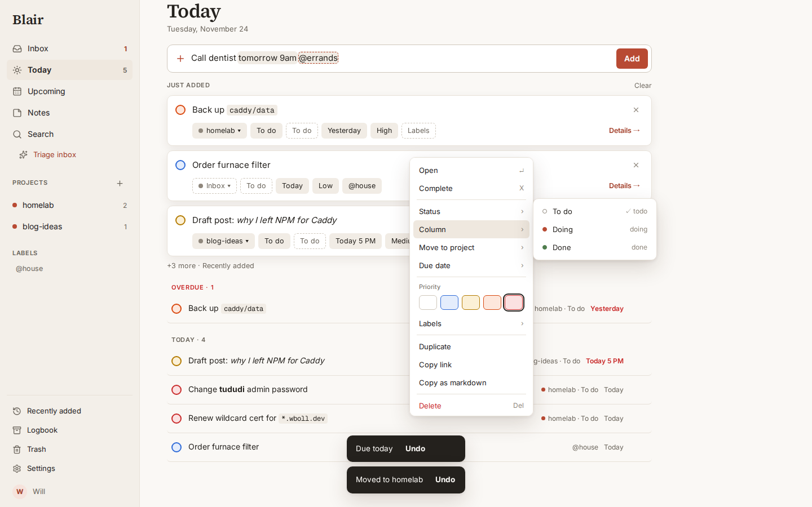
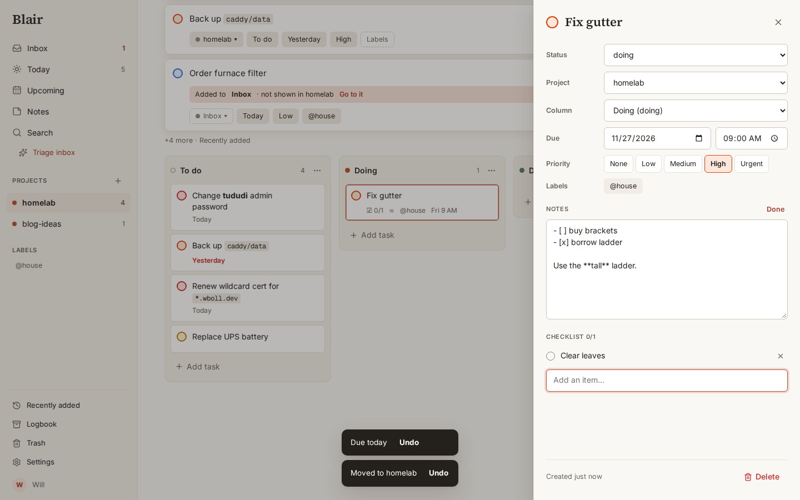
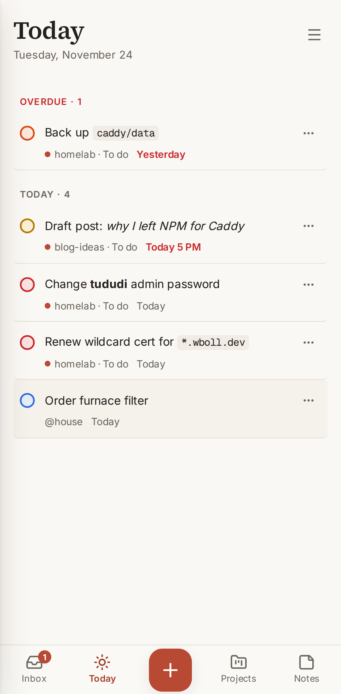
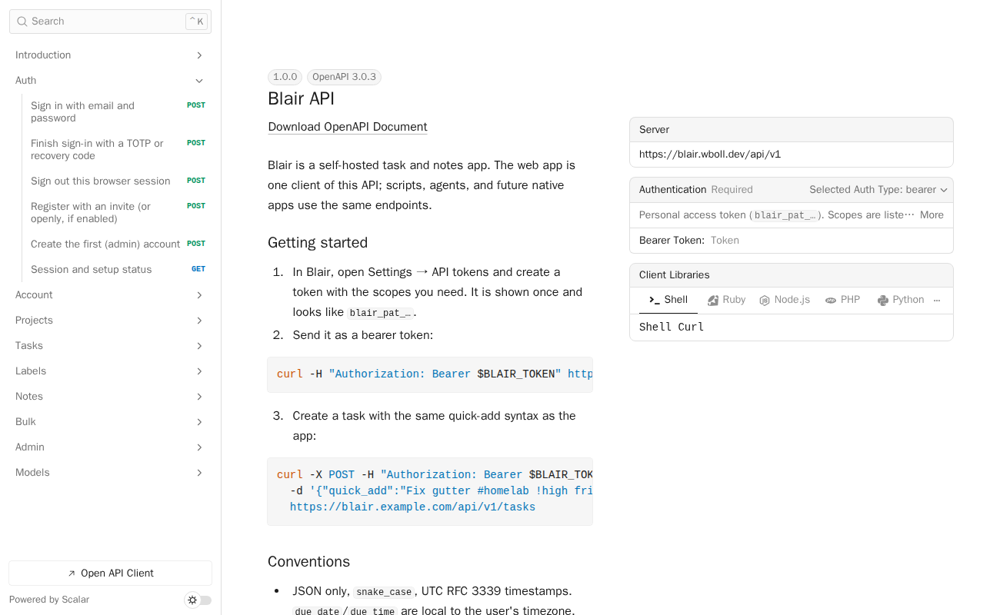

<h1 align="center">Blair</h1>

<p align="center">
  A self-hosted task app where the thing you just added doesn't vanish.
</p>

<p align="center">
  <picture>
    <source media="(prefers-color-scheme: dark)" srcset="docs/screenshots/today-dark.png">
    
  </picture>
</p>

Built because I got fed up with tududi. Every task app I tried has the same
problem: you type a task, hit enter, and it drops into some list you're not
looking at. Then you go hunting for it to set a project or a due date.

In Blair, new tasks land in a **Just added** tray at the top of whatever view
you're on. You can set the project, column, status, due date, priority and
labels right there, or drag the card onto a board column or a project in the
sidebar. If the current view would hide the task, the card tells you where it
went.

---

## What it does

- **Quick-add syntax.** `Fix gutter #homelab /doing !high fri 9am @house` sets
  the project, column, priority, due date and label. The tokens highlight as
  you type.
- **Repeating tasks.** `Take out trash every mon,thu 7am`. Completing one moves
  it to the next date and keeps the history.
- **Cmd/Ctrl+K palette** with fuzzy search across tasks, projects and views, and
  a **weekly review** page for what's unfiled, overdue, stuck or forgotten.
- **Right-click quick actions** on any task: status, column, move to project,
  due date, priority, labels, duplicate, delete. On a phone, long-press or tap `⋯`.
- **Kanban per project.** Columns are custom and reorderable, and each maps to
  a status, so moving a card to *Done* completes it.
- **Reminders and a notification bell.** Right-click → *Remind me*. The bell also
  flags security events, like a sign-in from a new browser or a failed 2FA check.
- **Works offline for capture.** Tasks added without a connection wait on the
  device and sync when you're back.
- Inbox triage, notes with markdown, checklists, search, Logbook, trash with undo,
  and keyboard shortcuts (press `?`).
- Installable as a PWA on iOS, macOS Safari and Android. Light, dark or system theme.

| Quick actions | Board | Task details |
|---|---|---|
|  |  |  |

<p align="center">
  
  &nbsp;
  
</p>

The screenshots come from the Playwright suite in `web/e2e`, which runs against
a real server.

## The API

Blair is API-first. The UI uses the same JSON API you get, described by
[`api/openapi.yaml`](api/openapi.yaml), with interactive docs at `/api/docs`.
Every HTTP test checks requests and responses against that contract.

- Personal access tokens with scopes (`tasks:read`, `tasks:write`, …).
- `POST /api/v1/batch` upserts by `(external_source, external_id)`, so rerunning
  an import doesn't duplicate anything. It supports `dry_run`.
- `GET /api/v1/export` returns everything as JSON or CSV.

There are no built-in importers. Point an agent at the OpenAPI spec and your old
app's export and let it do the mapping.



---

## Running

### Docker

```sh
docker build -t blair:latest .
docker run -d --name blair -p 127.0.0.1:8080:8080 -v blair-data:/data \
  -e BLAIR_BASE_URL=https://tasks.example.com blair:latest
docker logs blair 2>&1 | grep setup   # one-time admin setup link, valid for 1 hour
```

Put it behind a TLS reverse proxy. With Caddy:

```
tasks.example.com {
	reverse_proxy 127.0.0.1:8080
}
```

The image is distroless and runs as non-root. It also works with a read-only
root filesystem and `cap_drop: [ALL]`. Everything lives in `/data`: the SQLite
database, `secret.key` and the nightly backups.

### Admin CLI

The same binary does admin work:

```sh
blair user create | list | passwd | reset-2fa
blair backup
blair migrate
```

---

## Config

All config comes from environment variables. These are the ones you're likely to change:

| Variable | Default | Notes |
|---|---|---|
| `BLAIR_BASE_URL` | `http://localhost:8080` | Public URL. Used for links and cookie security |
| `BLAIR_REGISTRATION` | `closed` | `closed`, `invite` or `open` |
| `BLAIR_REQUIRE_2FA` | `false` | Force every account to enroll TOTP |
| `BLAIR_TRUSTED_PROXIES` | `127.0.0.1/32,::1/128` | CIDRs allowed to set `X-Forwarded-For` |
| `BLAIR_DATA_DIR` | `./data` | `/data` in the image |
| `BLAIR_BACKUP_INTERVAL` / `_KEEP` | `24h` / `14` | Online SQLite backups |
| `OTEL_EXPORTER_OTLP_ENDPOINT` | — | Turns on OpenTelemetry traces, metrics and logs |
| `BLAIR_PROMETHEUS` | `false` | Serves `/metrics` (with `BLAIR_METRICS_TOKEN`) |
| `BLAIR_DEBUG_ADDR` | — | pprof on a loopback address, e.g. `127.0.0.1:6060` |

The full list is in [docs/SPEC.md §14](docs/SPEC.md).

## Security

- Passwords are hashed with argon2id and checked against a breached-password list.
- 2FA uses TOTP and recovery codes. The TOTP secret is encrypted at rest. Codes
  can't be replayed.
- Sessions use `__Host-` cookies and can be revoked. API tokens are hashed and
  scoped. Admin endpoints work only with a session, not a token.
- CSRF protection and per-IP and per-account login rate limits. Strict CSP:
  hash-pinned scripts only, no `unsafe-inline`, no CDNs. An audit log records account events.
- Telemetry never carries task content, emails or tokens.

---

## Development

```sh
mise install && mise run hooks
mise run dev              # API on :8080
cd web && npm run dev     # UI with hot reload, proxies /api to :8080
mise run check            # lint, generated types, Go + web tests
```

Go 1.27 (CGo-free, `modernc.org/sqlite`), chi and goose. The frontend is
SvelteKit with Svelte 5, built as a static SPA and embedded in the binary.
Commits follow Conventional Commits, and a hook enforces it.

Spec-first: [SPEC](docs/SPEC.md) · [PLAN](docs/PLAN.md) · [ADRs](docs/adr/) ·
agent guide in [CLAUDE.md](CLAUDE.md).

## License

[MIT](LICENSE)
