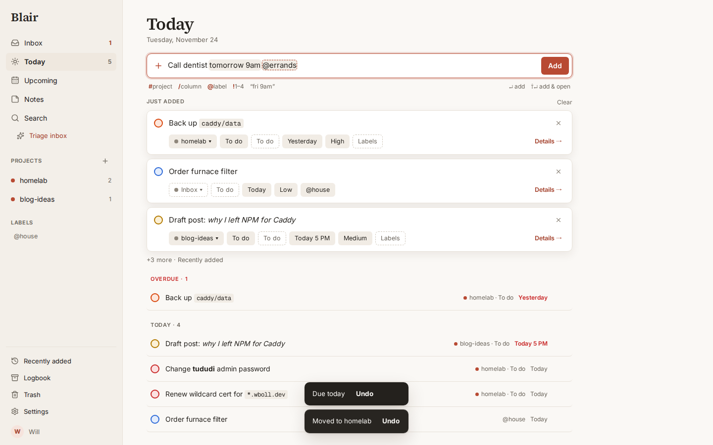
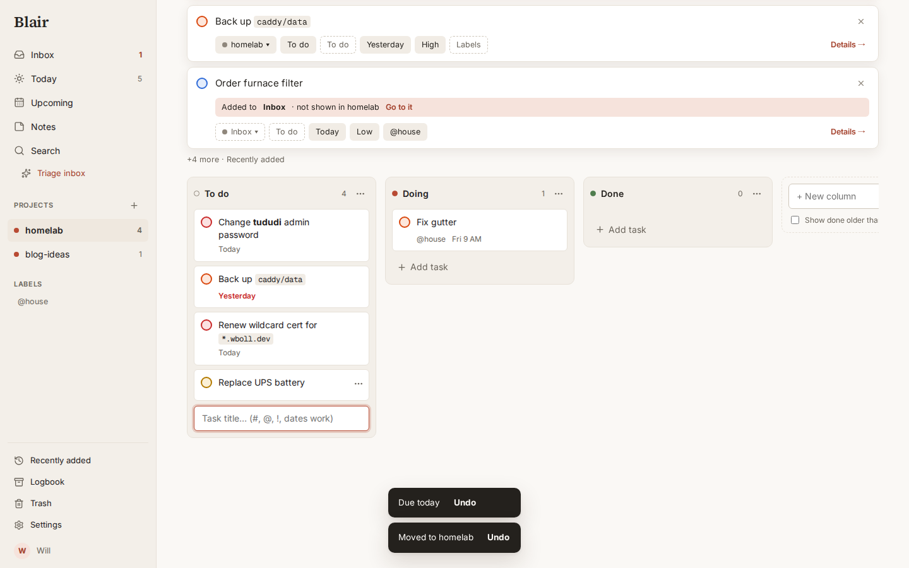
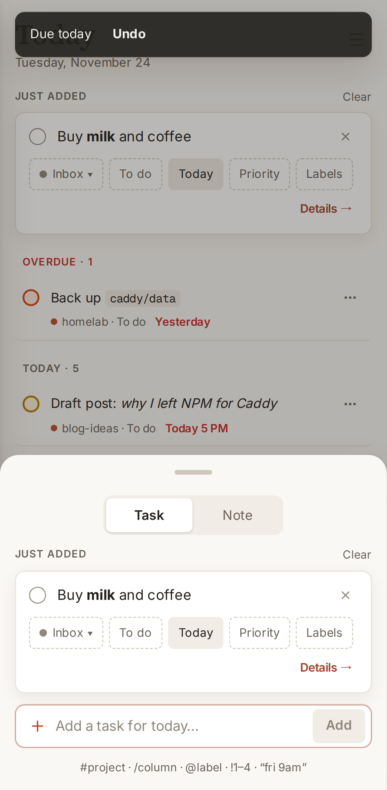

# Blair

A self-hosted task app. I built it because I got fed up with tududi.



My main gripe with other task apps: you add a task, it drops into a list you
can't see, and you go hunting for it to file it. In Blair, a new task stays at
the top of the page until you set its project, due date and so on.

Other things it does:

- Quick-add syntax: `Fix gutter #homelab /doing !high fri 9am @house`
- Repeating tasks: `Take out trash every mon,thu`
- Kanban per project, right-click actions, reminders, notes, checklists
- Ctrl+K to jump to anything, and a weekly review page for stale tasks
- An optional daily plan for standups ([docs/daily-plan.md](docs/daily-plan.md))
- Works as a PWA on phones, and can add tasks offline

| Board | Task details | Phone |
|---|---|---|
|  |  |  |

---

## Running

```sh
docker build -t blair:latest .
docker run -d --name blair -p 127.0.0.1:8080:8080 -v blair-data:/data \
  -e BLAIR_BASE_URL=https://tasks.example.com blair:latest
docker logs blair 2>&1 | grep setup   # one-time setup link
```

Put it behind a reverse proxy with TLS. Data lives in `/data` (SQLite, the
secret key, nightly backups). Settings are environment variables; see
[SPEC §14](docs/SPEC.md).

The same binary has admin commands: `blair user create|list|passwd|reset-2fa`,
`blair backup`, `blair migrate`.

## API

Everything the UI does goes through the API. Docs are at `/api/docs`, and the
spec is [`api/openapi.yaml`](api/openapi.yaml). There are no importers: give an
agent the spec and your old app's export, and let it use the batch endpoint.

`blairctl` is a small command line client for the API. Set `BLAIR_URL` and
`BLAIR_TOKEN` (a token with `tasks:read` and `tasks:write`), then run
`go run ./cmd/blairctl help`.

## Security

Accounts use argon2id passwords, TOTP 2FA and scoped API tokens. Registration
is closed by default. Logins are rate limited and the CSP is strict.

## Development

```sh
mise install && mise run hooks
mise run dev            # API on :8080
cd web && npm run dev   # UI with hot reload
mise run check          # lint and tests
```

Go and SQLite on the back end, SvelteKit on the front, built into one binary.
Design notes are in [docs/](docs/).

## License

[MIT](LICENSE)
